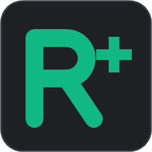
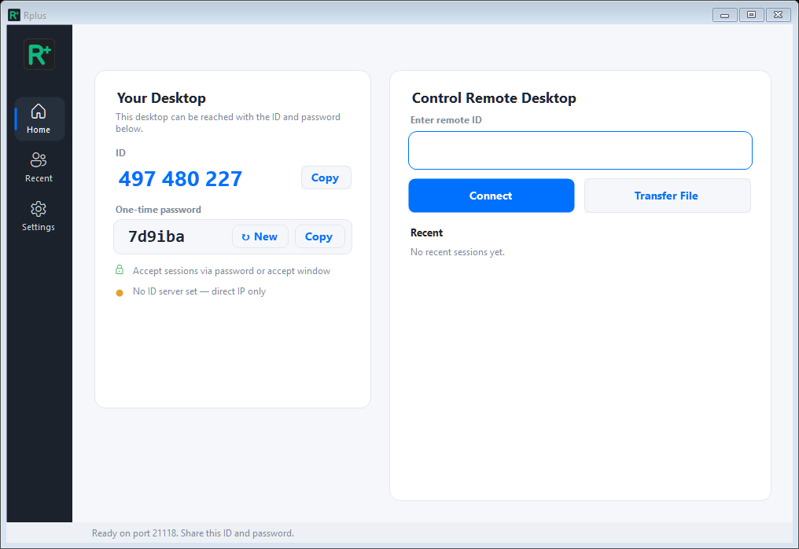
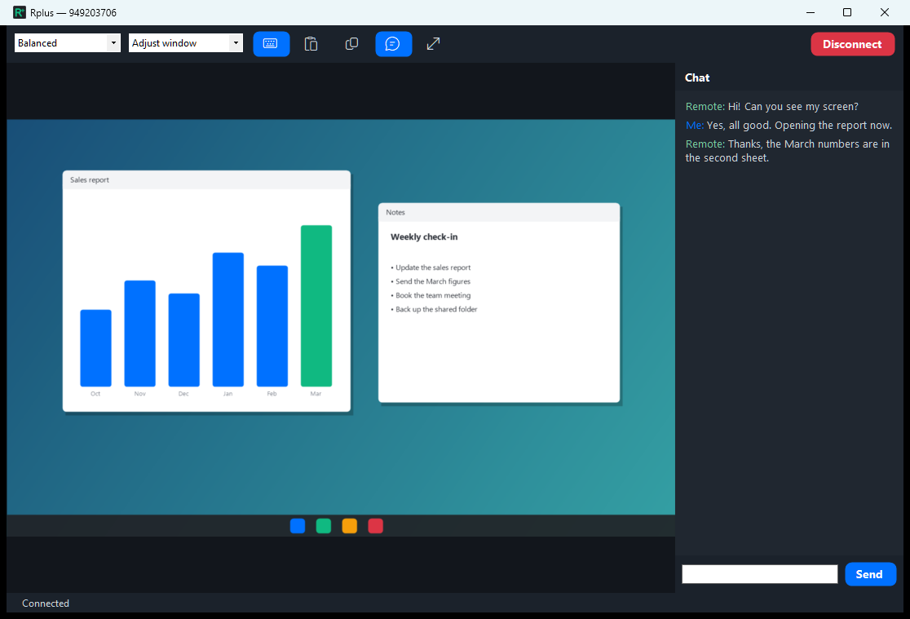
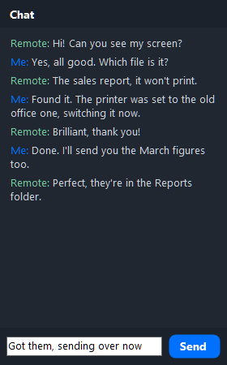
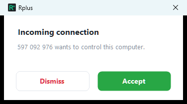
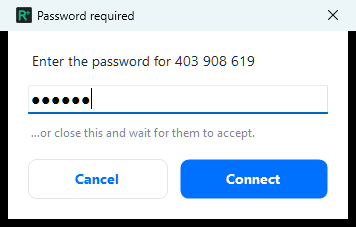
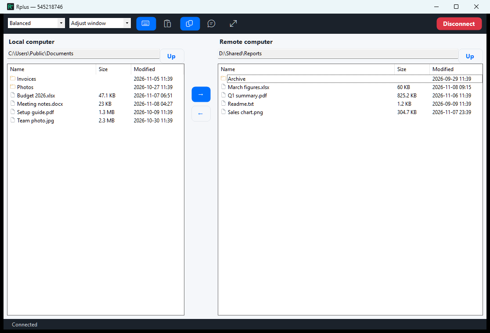
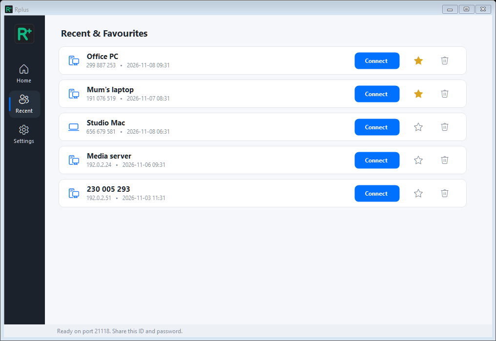
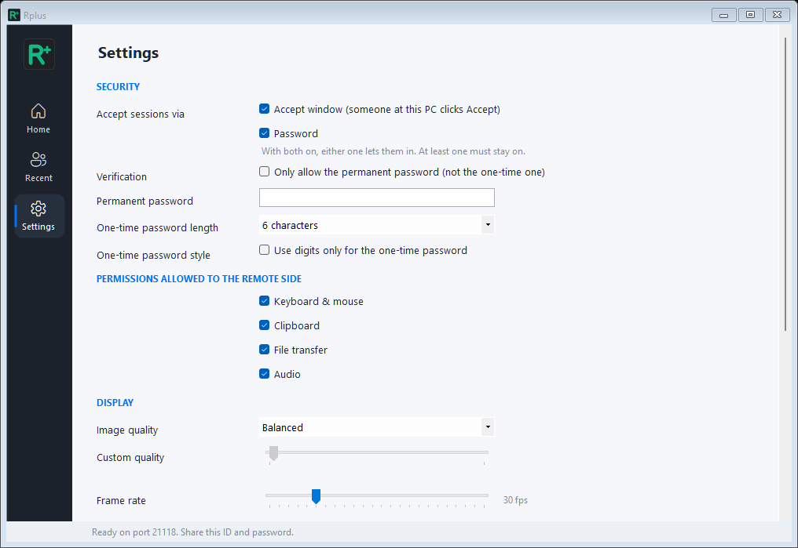

# Rplus



Remote desktop for Windows. Share your screen with an ID and a one-time password, or control
another computer running Rplus — on the same network, by direct IP, or through your own
self-hosted ID/relay server.








The session toolbar, left to right: image quality, view style (fit to window or original size),
**Keyboard** (send your key presses to the remote computer; the mouse always works), **Clipboard** (type your
clipboard text on the remote computer), **Files** (file transfer), **Chat**, **Full screen** and
**Disconnect**. Highlighted buttons are switched on.

When someone connects and "Accept window" is on in Settings, the shared computer shows:



When "Password" is on, the person connecting is asked for the password. With both on, they can
also close the prompt and wait for someone to click Accept:









## Download

Get `Rplus.exe` from the [latest release](https://github.com/muleskin/Rplus/releases/latest).
It's one self-contained file for 64-bit Windows, so you don't need to install .NET. Download it and run it.

Windows Firewall will ask to allow Rplus on your network the first time: allow it on private
networks so other computers can connect.

To try it out without touching your own settings, run `Rplus.exe --demo`. It opens with a random
ID, no ID server and no recent sessions, and saves nothing. Add `--screenshot <file.png>` to save a
picture of the home screen and exit (add `--page settings` or `--page recent` for those pages), which is handy for docs or demos that shouldn't show your
real ID or server. `Rplus.exe --session-screenshot <file.png>` does the same for the session
window, showing a made-up remote desktop instead of a real one; add `--files` for the file transfer
view with made-up folders on both sides, `--chat` for a close-up of the chat panel, or `--toolbar` for the toolbar.
`Rplus.exe --accept-screenshot <file.png>` saves the accept window for a made-up visitor.

## What it does

- **Your desktop:** a device ID made from the network card and a one-time password (6, 8 or 10
  characters, optionally digits only) with refresh and copy. Incoming connections can be
  approved by password, by clicking Accept, or both.
- **Control a remote desktop:** enter the remote ID or address and connect; recent sessions
  and favourites are kept on the home screen.
- **Session window:** image quality (best / balanced / low / custom), frame rate, original size
  or fit-to-window, keyboard and clipboard, file transfer, chat, full screen.
- **Own server:** point Rplus at a self-hosted ID server (hbbs, port 21116) and relay (hbbr,
  port 21117) plus its key, and two Rplus computers can find each other by ID across networks.
  Without a server it works over the LAN / direct IP on port 21118.
- One copy at a time; settings are in the Settings page.

Rplus only controls other computers running Rplus. `app/MECHANICS.md` lists the defaults and
the wire protocol.

## Building

Needs the .NET 8 SDK (or newer) on Windows.

```powershell
cd app
dotnet run                     # run from source
dotnet publish -p:PublishProfile=SingleExe   # single self-contained exe in app\publish\Rplus.exe
```
